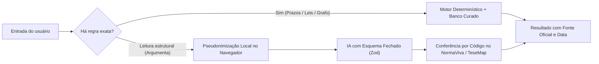

<div align="center">

# Ratione

**Plataforma de Inteligência e Rigor Jurídico**

*Cálculo determinístico onde há regra. Fonte oficial à vista onde há dado. IA apenas onde agrega leitura.*

[](https://github.com/junior-aguiar-eng/Ratione/actions/workflows/ci.yml)
[](LICENSE)
[](https://nextjs.org/)
[](https://www.typescriptlang.org/)
[](https://supabase.com/)

[**Acessar o site**](https://ratione.nexojuris.ia.br) · [**Metodologia**](apps/web/src/app/metodologia) · [**Documentação**](docs/README.md) · [**Plano**](docs/PLANO.md)

</div>

---

## O que é

O **Ratione** não é um chat jurídico genérico. Cada necessidade do dia a dia forense tem uma **ferramenta própria**, com método explícito, vínculo à fonte oficial e separação rigorosa entre código determinístico e inteligência artificial:

| Módulo | Pergunta que responde | Motor |
|---|---|---|
| ⏱️ [**PrazoZero**](#%EF%B8%8F-prazozero) | *Qual é o prazo final e por que cada dia contou?* | **100% determinístico** (sem IA) |
| 📜 [**NormaViva**](#-normaviva) | *Qual era o texto exato desta lei em determinada data?* | **Bitemporal determinístico** |
| 🕸️ [**TeseMap**](#%EF%B8%8F-tesemap) | *Como este precedente se relaciona com outras autoridades?* | **Grafo curado** (validação humana) |
| ⚖️ [**Argumenta**](#%EF%B8%8F-argumenta) | *Como esta decisão estrutura questões, fundamentos e citações?* | **Pipeline híbrido** (privacidade local + IA) |

---

## Os 4 módulos

### ⏱️ PrazoZero
Contagem de prazos processuais com **memória de cálculo auditável dia a dia**: cada feriado, suspensão ou recesso aponta o ato oficial de origem.
- **Regimes suportados:** CPC (dias úteis), CLT, Juizados Especiais (Lei 9.099/1995), CPP (dias corridos), além de prazos materiais (MS e ação rescisória).
- **Cobertura 2026:** STF, STJ, TST, 6 TRFs, 27 TJs e 24 TRTs com fonte registrada e modo conservador para dias pendentes.
- **Confiabilidade:** validado contra um **oráculo independente em Python** com **415 cenários** revisados juridicamente e **600 entradas aleatórias**.

### 📜 NormaViva
Linha do tempo da legislação brasileira compilada diretamente do Planalto, estruturada segundo a LC nº 95/1998.
- **Acervo:** **28 normas** essenciais (~**29 mil dispositivos** em artigo, parágrafo, inciso e alínea), nunca usando texto tachado como regra.
- **Consulta temporal e busca:** pesquisa tolerante a acentos, remissões navegáveis e histórico de redações revisado por humano.
- **Sincronia contínua:** verificação diária contra Planalto e Senado com aprovação humana antes de publicar alterações.

### 🕸️ TeseMap
Mapa interativo de precedentes qualificados e súmulas do **STF** e do **STJ**, com pesquisa textual e navegação em grafo (`React Flow`).
- **Acervo:** **7.734 nós** oficiais (temas repetitivos, repercussão geral, controle concentrado e súmulas).
- **Rigor nas conexões:** ligações entre precedentes e normas só são exibidas após validação humana com trecho literal conferido.

### ⚖️ Argumenta
Leitura estruturada de decisões judiciais coladas em texto, sem guardar o documento nem o resultado no servidor.
- **Privacidade por padrão:** **pseudonimização no navegador** antes de qualquer envio (nomes, OAB, CPF/CNPJ, processos e endereços são trocados localmente).
- **Rastreabilidade:** separa relatório, preliminares, questões, fundamentos e monta o **mapa de argumentos**, com selo automático conferindo cada citação contra o **NormaViva** e o **TeseMap**.
- **Avaliação objetiva:** medido em corpus próprio de 30 decisões públicas revisadas ([relatório](docs/produto/ARGUMENTA_AVALIACAO.md)).

---

## Como a confiança funciona



- **Sem caixas-pretas:** IA nunca calcula prazo nem escolhe redação vigente de lei.
- **Isolamento e LGPD:** autenticação via Supabase com **RLS em todas as tabelas**, retenção mínima com limpeza diária automática e exclusão autônoma da conta.
- **Conta e uso transparentes:** histórico em análises (não em tokens), exportação CSV e painel administrativo isolado no servidor.

---

## Arquitetura

```text
Ratione/
├── apps/web/          # Next.js 16 (App Router), React 19, Tailwind CSS 4, React Flow
├── packages/
│   ├── core/          # Tipos, tribunais e procedência compartilhada
│   ├── prazozero/     # Motor de prazos, calendários e oráculo em Python
│   ├── normaviva/     # Parser LC 95/98, busca e vigência bitemporal
│   ├── tesemap/       # Coleta e grafo de precedentes (STF/STJ)
│   ├── argumenta/     # Segmentação, pseudonimização e contratos de análise
│   └── db/            # Testes de RLS e segurança no PostgreSQL (PGlite)
├── supabase/          # Migrações SQL versionadas e correções de dados
├── docs/              # Metodologia, fontes, plano, deploy e documentos jurídicos
└── .github/workflows/ # CI, deploy no Cloud Run e rotinas de atualização
```

| Camada | Tecnologias |
|---|---|
| **Aplicação** | Next.js 16 (Turbopack), React 19, TypeScript, Tailwind CSS 4, shadcn/ui, React Flow |
| **Dados & Auth** | PostgreSQL no Supabase (São Paulo) com Row Level Security (RLS) |
| **IA** | Anthropic Claude SDK com saída estruturada validada via Zod |
| **Infra & Testes** | Google Cloud Run, `node:test` + `tsx`, PGlite, Python 3.12 (oráculo) |

---

## Como executar localmente

Pré-requisitos: **Node.js 26** e **[pnpm 11](https://pnpm.io)**.

```bash
pnpm install
cp apps/web/.env.example apps/web/.env.local   # preencha URL e chave publicável do Supabase
pnpm dev
```

<details>
<summary><strong>Comandos principais de verificação e avaliação</strong></summary>

```bash
pnpm test                                  # suíte completa (motores, oráculo, RLS e web)
pnpm typecheck                             # verificação de tipos em todo o monorepo
pnpm build                                 # build dos pacotes e da aplicação web
python packages/prazozero/cenarios/oraculo.py  # regenera/confere o gabarito do PrazoZero
pnpm --filter web avaliacao                # executa avaliação do corpus do Argumenta
```

</details>

---

## Estado atual e documentação

| Módulo | Estado | Detalhes |
|---|---|---|
| **PrazoZero, NormaViva, TeseMap** | 🟢 Em produção | Atualizações diárias/semanais e fontes auditadas |
| **Argumenta** | 🟢 Em produção (beta) | Análise de texto no ar; envio/salvamento de arquivos prontos e desligados |
| **Planos e Cobrança** | 🟡 Parcial | Cotas por análise ativas; cobrança Mercado Pago desligada até ativação comercial |

- **Índice completo da documentação:** [`docs/README.md`](docs/README.md)
- **Plano único e roteiro:** [`docs/PLANO.md`](docs/PLANO.md)
- **Banco e migrações:** [`supabase/LEIA-ME.md`](supabase/LEIA-ME.md)
- **Deploy e operação:** [`docs/deploy/CLOUD_RUN.md`](docs/deploy/CLOUD_RUN.md)
- **Conformidade e minutas:** [`docs/juridico`](docs/juridico)

---

<div align="center">

Licença [MIT](LICENSE) © Junior Aguiar

</div>
